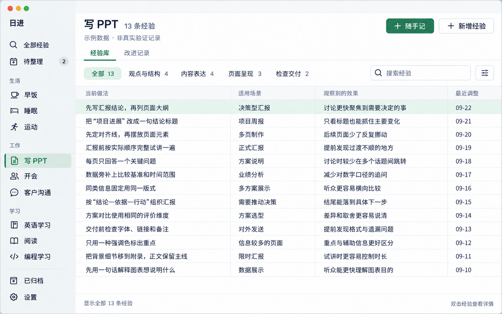
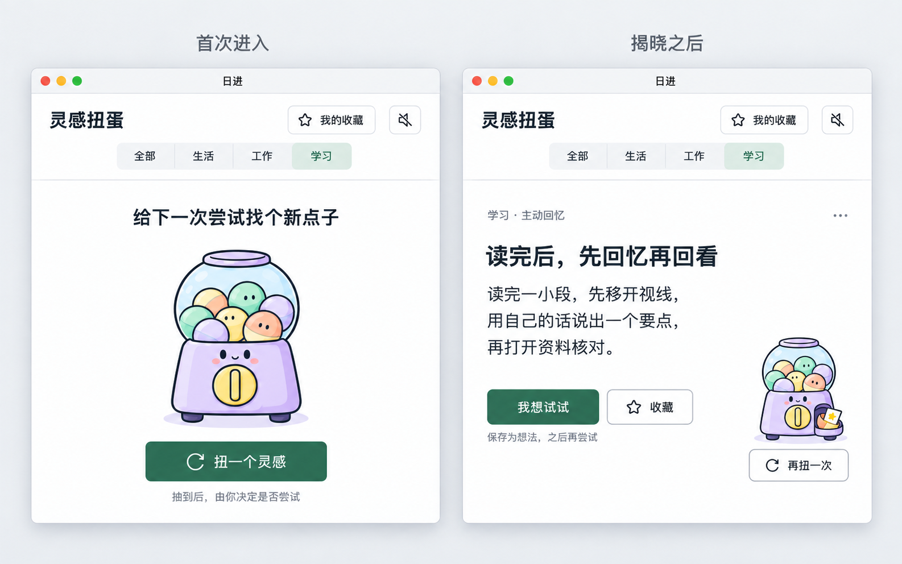

# 日进 PRD v0.2

个人行为改进与经验库 · macOS

版本：0.2｜日期：2026-09-23｜状态：需求评审稿，尚未开发

本文将会话中已确认的方向整理为需求，并为尚未讨论的操作细节给出建议默认值。标记为“建议”的内容不代表用户已经确认。原型中的记录、效果和日期均为演示数据，不代表真实验证成果。产品名称“日进”为暂用名。

## 1. 产品摘要

帮助个人随时记录生活、工作、学习中的行为调整，按事项连续观察结果，把确实有帮助的方法沉淀为经验，下次做同一件事时能够找到并复用。

核心循环：随手记录 → 按事项整理 → 尝试与观察 → 判断效果 → 沉淀经验 → 查阅复用 → 新一轮改进。

灵感扭蛋在没有思路时提供一个候选小动作，采纳后进入想法记录，再经本人尝试与观察形成经验。记录是入口，经验是长期成果。产品不要求每天创新，也不把记录数量解释成成长幅度。

## 2. 需求依据与目标用户

### 2.1 已确认的需求

| 会话中的需求 | 对应产品决定 |
| --- | --- |
| 在 Mac 上记录生活和工作改进 | macOS 个人使用场景，以事项长期组织 |
| “想到就记” | 快捷入口优先，内容必填，分类可后补 |
| 将试验确实有帮助的经验沉淀下来 | 改进记录与经验分开保存并建立关联 |
| 展示密集，不想一页只能看几条 | 紧凑表格、单行摘要、详情按需打开 |
| 分组有用，展开箭头太乱 | 顶部按组筛选，表内平铺，无逐行展开 |
| 增加“学习”一级分类 | 一级分类为生活、工作、学习 |
| 暂不考虑 SOP | 本版不做 SOP、执行清单或流程模板 |
| 没灵感时获取可做的小动作 | 预置行动签，随机揭晓，由本人决定是否尝试 |
| 扭蛋可以卡通，整体页面要简洁 | 仅机器插画卡通，揭晓后突出动作内容 |
| 学习侧重方法，而非具体学科 | 200 条通用学习方法，面向在职成年人 |

### 2.2 目标用户与问题

首要用户为本人：经常使用 Mac，希望随时捕捉做事方法的变化，并在后续生活、工作、学习中复用。尚未验证更广泛人群，不假定团队协作或商业化需求。

待解决的问题：零散想法难以积累；同一事项的历史变化难以追溯；记录了过程却没有形成可用结论；卡片和多层展开影响大量经验的查阅。

使用目标：想到调整时迅速保存；回到事项时知道试过什么；下次行动前能够找到适用的经验。

## 3. 范围与设计原则

### 3.1 本版范围

三类事项管理、随手记、待整理、改进记录、观察结果、沉淀及更新经验、事项内分组、密集表格、搜索筛选、按需查看详情、归档恢复；新增灵感扭蛋、三类共 600 条候选行动签、收藏与采纳。

一级分类首版固定为生活、工作、学习；事项可自定义。固定分类是建议默认值，自定义一级分类暂列后续。分类内的示例事项不自动写入真实用户数据。

### 3.2 本版不包含

SOP；积分与连续打卡；成长分数和复利曲线；AI 自动判断有效性或总结；团队协作；手机端；云同步；文件附件；复杂统计和实验因果分析。技术框架、付费服务、发布渠道不在本 PRD 中选定。

### 3.3 原则

- 保存优先：不要求先分类、先验证或先写完整复盘。
- 过程与结论分开：编辑错字不能代替记录一次新的观察。
- 判断由本人确认：“有效”是特定条件下的个人判断，不是系统证明。
- 一张主表：默认没有右侧或底部详情，没有行内嵌套表格。
- 缺省也是合法状态：未分类、待观察、未分组都可以保留，不制造逾期压力。

## 4. 信息架构与名词

```text
日进
├─ 全部经验
├─ 待整理
├─ 灵感扭蛋 → 全部 / 生活 / 工作 / 学习 → 我的收藏
├─ 生活 → 早饭、睡眠、运动……
├─ 工作 → 写 PPT、开会、客户沟通……
├─ 学习 → 英语学习、阅读、编程学习……
├─ 已归档
└─ 设置

每个事项
├─ 经验库 → 全部 / 自定义组 / 未分组
│  └─ 经验详情 → 当前做法、适用条件、效果、关联记录
└─ 改进记录 → 原始想法、尝试、后续观察、判断
```

| 名词 | 定义与边界 |
| --- | --- |
| 分类 | 生活、工作、学习，一个事项属于一个分类 |
| 事项 | 可持续改善的主题，例如写 PPT；不是一次性的待办任务 |
| 改进记录 | 一次想法或调整；可包含多次后续观察 |
| 观察 | 在某个时间对原调整效果的补充，保留观察发生日期 |
| 经验 | 值得再次使用的当前做法，带适用条件和观察依据 |
| 分组 | 单个事项内的经验筛选维度；例如写 PPT 的“内容表达” |
| 待整理 | 未归入事项的记录集合，不是第四个分类 |

建议首版每条经验最多属于一个分组，避免计数重复；未设置分组进入“未分组”。分组不适用于事项层级，不形成多级目录。

## 5. 核心流程

```text
想到新办法 / 已经做了调整
             ↓
         随手记保存
      ┌──────┴──────┐
   未选事项       已选事项
      ↓              │
    待整理            │
      ↓              │
   选择/新建事项 ──────┘
             ↓
        事项改进记录
      ┌──────┴──────┐
   尚未尝试        已经尝试
      ↓              │
   实际尝试 ──────────┘
             ↓
     补充观察与个人判断
   ┌─────────┼─────────┐
待观察       不采用       有效、值得复用
   ↓          ↓              ↓
继续观察   留下原因     新建经验 / 更新经验
   └──回到观察              ↓
                     按组筛选、查阅复用
                            ↓
                    有新发现再随手记录
```

不是每条记录都要进入经验库。允许直接新增经验，但需本人确认“这是我已尝试、愿意复用的做法”；没有关联记录时明确显示“未关联记录”，不伪造验证次数。

## 6. 页面原型

### P01 事项经验库：已确认方向，补入学习分类



这是静态视觉原型，不是已实现功能。图中文字以本文字段与交互规则为准。

布局：左侧事项导航；上方事项标题和新增入口；“经验库 / 改进记录”视图切换；单排分组筛选与搜索；下方单张经验表。显示全部时各组经验直接平铺，不插入分组标题。

默认列：当前做法、适用场景、观察到的效果、最近调整。组筛选是单选，包含“全部”；有未分组数据时才显示“未分组”。组数超过可用宽度时使用“更多分组”菜单，不换成多排大标签。

默认按最近调整倒序；同一时间按创建时间、内部 ID 稳定排序。查看经验不修改最近调整时间；更新经验正文、场景或效果才修改。单行摘要可截断，完整内容在详情中读取。

建议在 1440 × 900 窗口、默认字体下可看到至少 13 条数据，行高约 32–36 pt。窄窗口优先保留当前做法，其他列允许横向滚动，不能缩小到难以阅读。

### P02 随手记：低保真交互原型

```text
┌──────────────────────────────────────────────┐
│ 随手记                                    × │
│ 日期：2026-09-22                              │
│ 内容                                         │
│ ┌──────────────────────────────────────────┐ │
│ │ 今天先写每页结论，再找素材，整理更顺畅。 │ │
│ └──────────────────────────────────────────┘ │
│ 事项：暂不分类        类型：未选择            │
│ 可以先保存，之后再整理                        │
│                             保存记录  ⌘↵    │
└──────────────────────────────────────────────┘
```

入口：主窗口按钮、菜单栏、自定义全局快捷键。全局入口默认不选事项；事项页面打开时预选当前事项且可更改。仅内容必填；日期默认今天，可补记。保存成功后收起；失败保留草稿，明确显示未保存。

### P03 事项改进记录：低保真交互原型

```text
写 PPT                                      ＋随手记
经验库  [改进记录]
全部  想法  待观察  保留  不采用             搜索记录
日期       本次调整                  最近观察       判断    关联经验
09-22      先写结论，再找素材         初稿更顺畅     保留    结论先行
09-21      准备增加一页背景说明       —              想法    —
09-20      将背景移到附录             还需试讲       待观察  —
```

这里的状态筛选用于过程判断，和经验库的分组筛选是不同概念。单击选中、双击或按 Enter 打开记录详情；详情内可以补充观察、改变判断、沉淀经验。

### P04 经验详情与沉淀：低保真交互原型

```text
经验详情：先写汇报结论，再列页面大纲                关闭
[当前经验]  关联记录 2                              编辑
当前做法：先明确需要决定什么，再列出页面大纲。
适用场景：决策型汇报
观察效果：讨论更快聚焦到需要决定的事。
注意事项：探索性讨论可能需要先梳理问题。
所属分组：观点与结构
最近调整：2026-09-22

关联记录
09-22  本次调整与观察……                            查看
09-19  本次调整与观察……                            查看
```

建议详情使用独立浮层；主表保持筛选、排序、滚动位置。不是常驻面板，不展开主表行。关联记录作为“形成经验的过程”，首版不做任意正文版本的差异比较。

沉淀入口提供“新建经验 / 补充已有经验”。新建需选择事项、填写当前做法并确认复用意愿；适用场景、效果、注意事项和分组可后补。更新已有经验时先展示待保存内容，由本人确认，不自动覆盖。

### P05 待整理：低保真交互原型

```text
待整理                                           2 条
日期       内容摘要                         操作
09-22      读完一节后先合上书复述……          归入事项
09-21      做 PPT 时先写每页结论……           归入事项

归入事项：搜索事项 / 按生活、工作、学习选择 / 新建事项
```

归入后从待整理消失，出现在目标事项；正文、原始发生日期、观察记录不变。不要求清空，也不使用逾期提醒。

## 7. 功能需求与验收标准

以下 P0 为本 PRD 建议的首版必需范围。状态、数据保护及交互细节为基于会话补齐的建议，评审后冻结。

| ID | 功能 | 可验证的验收标准 |
| --- | --- | --- |
| F01 | 三类事项导航 | 启动后看到生活、工作、学习；可在任一分类创建事项；切换事项只显示该事项数据 |
| F02 | 事项维护 | 重命名后原记录和经验关联不变；建议支持移至其他分类；同一分类名称重复时提示，不静默覆盖 |
| F03 | 快速记录 | 仅填写非空正文即可保存；不选事项进入待整理；从事项页唤起预选该事项；快捷键冲突时允许重新设置 |
| F04 | 草稿与失败 | 未保存关闭小窗后再次打开能恢复草稿；保存失败不清空内容；重复触发保存不生成重复记录 |
| F05 | 待整理 | 归入已有或新建事项后，待整理减少一条、目标增加一条；原日期与内容保持一致 |
| F06 | 记录与观察 | 可补记日期、编辑原始文字；追加观察必须保留独立日期；最近观察摘要可见，完整历史可查 |
| F07 | 判断状态 | 允许未选择、想法、待观察、保留、不采用；改变判断不删除旧观察；无效尝试不会自动消失 |
| F08 | 新建经验 | 从记录沉淀后原记录仍存在；经验与记录建立关联；确认有效由本人操作，系统不自动推断 |
| F09 | 补充已有经验 | 在同一事项内选择目标经验并确认更新；不新建重复经验；关联同一记录两次不重复计数 |
| F10 | 直接新增经验 | 必须选择事项并填写当前做法；确认复用意愿后保存；可无关联记录，详情如实标示 |
| F11 | 按组筛选 | 点击组只显示该组；全部平铺显示全部有效经验；返回同一事项恢复上次组选择，失效选择回退全部 |
| F12 | 分组维护 | 可新建、重命名、调整次序；一条经验最多一个组；经验可回到未分组；无组时只显示全部 |
| F13 | 搜索与排序 | 事项搜索覆盖当前做法、场景、效果及注意事项；搜索与组筛选取交集；清空搜索仍保留组选项 |
| F14 | 全部经验 | 展示三类中未归档事项的经验，增加“所属事项”列；跨事项搜索；不混用不同事项的分组 |
| F15 | 详情阅读 | 默认主窗口只有一张表；双击或 Enter 打开详情；关闭回到原滚动位置；无行内展开箭头 |
| F16 | 归档恢复 | 首版建议以归档替代永久删除；事项归档后子数据保留、不出现在普通搜索；恢复后关联不丢失 |
| F17 | 经验失效 | 经验可标记不再适用并归档；不篡改当时有效的观察；不再适用的经验默认不作为当前方法展示 |

### 7.1 状态边界

类型与判断分开：记录类型为未选择、想法、已尝试；判断为待观察、保留、不采用，仅已尝试记录适用。P03 的筛选标签为这两个字段的用户视图，不另存第三份状态。

将想法改为已尝试时默认待观察。保留与不采用可因新观察重新判断；不自动删除或更新已关联的经验，由用户确认是否修改。仅编辑文字不自动改变判断。未知结果显示“未记录”，不推断有效或无效。

### 7.2 筛选与计数

经验库默认只显示当前有效、未归档的经验。顶部事项总数为该范围总数；分组数字为搜索前该组总数，不随关键词改变；底部显示当前匹配条数，例如“匹配 2 条，共 13 条”。全部、各组与未分组的计数遵守单组归属，不重复累计。

### 7.3 边界情况

- 没有事项：展示新建事项入口，仍可随手记入待整理。
- 分组无记录：提示“此组暂无经验”，提供新增或切回全部。
- 搜索无结果：提示清空关键词或切换组，不显示空白错误页。
- 关联记录不可见：归档不会断开关联；从经验仍能查看归档记录并显示归档标记。
- 跨事项移动：已建立经验关联的记录首版建议禁止直接移动，先明确关联归属；提示原因，不静默断开关系。
- 长文本：表格截断，详情完整可选中复制；不为了塞满一行缩小字体。
- 跨年日期：表内显示完整年份；数据始终保存完整日期，不只存月日。
- 多组溢出：更多分组菜单中保持选中状态可见，不产生第二排筛选栏。

## 8. 概念数据结构

本节定义业务对象，不选择数据库或开发框架。

| 对象 | 主要字段 | 约束 |
| --- | --- | --- |
| 分类 | ID、名称、顺序 | 生活、工作、学习三个默认项 |
| 事项 | ID、分类 ID、名称、改善目标、归档状态 | 分类必填，目标选填 |
| 分组 | ID、事项 ID、名称、顺序 | 仅属于一个事项 |
| 改进记录 | ID、事项 ID、内容、发生日期、类型、判断、创建/更新时间 | 事项可空，内容必填 |
| 观察 | ID、记录 ID、观察日期、内容 | 同一记录可有多条 |
| 经验 | ID、事项 ID、分组 ID、当前做法、场景、效果、注意事项、有效/归档状态、创建/调整时间 | 事项和当前做法必填；分组可空 |
| 经验与记录关联 | 经验 ID、记录 ID | 多对多，不重复；首版限同一事项 |
| 草稿 | 正文、可选事项、日期、类型 | 未保存时单独保留，不计为正式记录 |

保留发生时间和录入时间的区别。增加关联但没有修改经验结论时，不误写其内容调整时间；可另记关联更新时间。

## 9. 示例与验收场景

### 9.1 三类一致性

| 分类 | 事项示例 | 分组示例 | 经验示例 |
| --- | --- | --- | --- |
| 生活 | 早饭 | 前晚准备、早上制作、吃完收尾 | 提前分装次日食材 |
| 工作 | 写 PPT | 观点与结构、内容表达、页面呈现、检查交付 | 先写结论，再列大纲 |
| 学习 | 英语学习 | 输入理解、主动回忆、输出练习、复习 | 学完后不看笔记复述，再对照补缺 |

这些是原型与验收数据，不预装成已经验证的用户经验。学习分类使用完全相同的记录、观察、经验机制，不变成课程管理或学习打卡系统。

### 9.2 端到端验收

1. 在没有事项的情况下随手记录一句学习方法，重启后在待整理中找到。
2. 在学习下创建“英语学习”，将记录归入；原时间不变。
3. 将想法改为已尝试，追加两条不同日期的观察。
4. 确认保留并沉淀经验，归入“主动回忆”；原记录仍可从经验打开。
5. 切换到工作中的写 PPT，不能看到英语学习的数据。
6. 回到英语学习，通过组筛选和关键词找到经验；打开详情再关闭，表格位置不变。
7. 新增一条后续尝试，补充到已有经验；经验数量不增加，关联记录增加。
8. 标记经验不再适用并归档，再恢复，原观察和关联完整保留。

## 10. 非功能要求与验证目标

| 方面 | 建议验收要求 |
| --- | --- |
| 数据可靠性 | 成功保存的记录在关闭和重启后仍存在；保存错误明确可见，不假报成功 |
| 离线 | 建议核心记录与查阅在无网络时可用；存储方案待技术评审 |
| 隐私 | 不默认上传记录，不默认接入 AI；本文不引入外部账号或服务；灵感使用预置签库，不依赖在线生成 |
| 键盘 | Tab 顺序合理；保存、打开详情和关闭详情可用键盘完成；焦点清晰 |
| 可读性 | 状态同时有文字；正文不过度缩小；表格支持完整内容阅读 |
| 性能 | 建议在约定测试 Mac、1 万条记录下，搜索与切换筛选 P95 小于 500 ms；硬件与测量方法开发前确定 |
| 数据备份 | 持久化、备份/导出恢复方案必须在开发前确定；不将“写入本机”视为已经解决备份 |

以上为目标，不是已达到的测试结果。当前没有产品代码或运行性能基线。

### 10.1 试用成功指标

均为待验证目标，基线未知，不宣称已有成效；建议用本人两周试用手工记录，不默认接入分析服务。

| 指标 | 基线 | 建议目标与测量窗口 |
| --- | --- | --- |
| 记录摩擦 | 未测量 | 第一周 10 次短句记录，从唤出到保存中位数不超过 15 秒 |
| 找回效率 | 未测量 | 第二周 10 次指定经验查找，至少 8 次在 20 秒内完成 |
| 实际复用 | 未测量 | 两周内至少 3 次在真实事项中查阅并使用旧经验 |
| 沉淀有效性 | 未测量 | 两周内至少 2 条经验能追溯到自己的尝试与观察 |
| 数据保护 | 未测量 | 端到端验收中零条已确认保存记录丢失 |

不以记录总数、连续天数或虚构的“成长百分比”作为主要成功指标。

## 11. 依赖、成本与风险

本次交付为需求文档与静态原型，不新增付费服务、订阅、API 或服务器。未承诺开发费用与发布时间；尚未选择技术方案。

若后续涉及商店发布、开发者账号、云同步、AI API 等，必须在采用前核对并披露必需/可选、开发/发布、一次性/持续费用，取得同意后再引入。

| 风险 | 处理方向 |
| --- | --- |
| 记录越积越多，但没有复用 | 首页围绕事项和经验；试用衡量真实查阅，而非记录量 |
| 整理负担导致不愿记录 | 允许未分类与未分组，只要求内容 |
| 把个人观察误当因果证明 | 明确适用条件和依据，系统不自动宣判有效 |
| 表格文字较长、信息变乱 | 列宽与单行摘要，详情按需，顶部单排筛选 |
| Mac 不在身边导致忘记 | 先验证 Mac 使用习惯；手机端不因此自动纳入首版 |
| 归档或更新破坏历史 | 稳定 ID、关联保留、更新需本人确认 |

## 12. 待确认事项与交付计划

已确认：macOS；想到就记；生活、工作、学习；事项为主线；改进记录与经验关联；密集表格；按组筛选；灵感小动作与扭蛋方向；仅扭蛋卡通；不做 SOP。

建议默认、尚待评审：事项内单组归属；浮层详情；记录类型/判断状态；一级分类固定；优先归档；本地离线；组溢出菜单；搜索和计数规则。

开发前必须确定：最低 macOS 版本、设备范围、存储与恢复方案、是否仅个人自用或计划分发、快捷键、长文编辑范围。无需在文档阶段强行选择框架或购买服务。

建议先走查 P02 → P05 → P03 → P04 → P01 的完整原型路径，并走查 P06 → P07 → P08 → P05 的灵感采纳路径，再实现记录到复用的最小闭环。待两周实际使用后决定是否扩展，而不是先增加统计或自动化。

## 13. 灵感扭蛋

### 13.1 目的与范围

当没有改进思路时，获取一个可以尝试的小动作，由本人决定是否采纳。扭蛋是内容揭晓方式，不是收益或奖励机制。抽到不等于尝试，采纳不等于完成，尝试不等于有效。

本版采用预置候选签库，不依赖在线生成、AI API 或付费服务。初始内容为生活、工作、学习各 200 条，共 600 条；每类 20 个主题，每主题 10 条。学习签面向在职成年人的通用学习方法，围绕理解、回忆、练习、反馈、迁移与复盘，不按 AI 等学科划分，也不采用高中应试内容。主题是内容组织标签，不自动创建用户事项。

用户明确偏好：直接提供小动作；选择扭蛋交互；扭蛋可以卡通，但整页与建议展示必须简洁；建议是主体，扭蛋是辅助。两状态布局、动画时间、随机规则及恢复行为是建议默认值，待实际原型走查验证。

### 13.2 入口与页面

建议在主窗口左侧“待整理”下增加“灵感扭蛋”入口；原 P01 静态图未画出该新增入口，以此条需求为准。进入扭蛋功能不丢失主表的事项、筛选和滚动位置。建议使用可关闭的独立窗口；收藏在同一窗口内切换，返回保持原结果。

顶部包含标题、我的收藏、音效开关。分类单独一行：全部、生活、工作、学习。首次默认全部，之后记住上次选择。分类只限制抽取池，不等于选定用户事项。

### P06–P07 两状态视觉原型



左图 P06：尚无结果时，适中尺寸的卡通扭蛋机作为入口，按钮“扭一个灵感”。右图 P07：结果揭晓后，行动文字成为主体，小扭蛋移至右下角，提供“再扭一次”。图片是静态参考，未实现动画。

页面白底、常规字体、绿色强调、细分隔线；不使用装饰卡片、粗描边、贴纸、夸张字体。仅机器插画采用卡通风格。结果包含主题、动作内容、采纳、收藏和次级菜单。600 条源内容目前只有 action；原型中的短标题是展示示例，不是签库已具备的字段。首版可直接以 action 作为主文案，不能为了凑标题调用 AI 或重复展示相同句子；如需标题须另行编辑入库。

### 13.3 状态转换

```text
进入灵感扭蛋
  ├─ 尚无当前结果 → 首次进入
  └─ 有保留结果   → 显示上次结果
选择范围 → 点击扭一个灵感 → 选定候选 → 播放短动画 → 揭晓
揭晓
  ├─ 再扭一次 → 新一轮抽取（不创建改进记录）
  ├─ 收藏     → 加入我的收藏（不创建改进记录）
  ├─ 我想试试 → 编辑动作/选择事项 → 确认保存 → 一条“想法”记录
  │                                             ├─ 未选事项 → 待整理
  │                                             └─ 已选事项 → 对应改进记录
  └─ 更多 → 不再推荐这条 → 加入屏蔽集合，可在设置中恢复

想法 → 实际尝试 → 观察与判断 → 沉淀经验
```

### 13.4 采纳与收藏

“我想试试”先打开轻量编辑框：动作正文必填，事项可选，日期默认今天。允许改写为适合自己的动作；保存后类型为想法、无有效性判断。未选事项进入待整理，选择事项进入该事项。分类不限制事项选择，学习灵感也可以用于工作事项。

只有保存成功才记为已采纳。取消编辑不创建记录，不标记采纳；失败保留输入。重复点击保存只创建一条记录。采纳后当前卡按钮改为“查看想法”，避免同一条签重复导入。现有记录以后被归档，采纳关联仍保留。

收藏独立于采纳：收藏只是“留着再看”，不进入待整理、任务或经验库。已收藏显示“已收藏”，可再次点击取消。已采纳内容可以继续收藏。更多菜单使用“不再推荐这条”，不将普通换签或临时不适合当成永久屏蔽。

### P08 收藏与采纳低保真原型

```text
我的收藏                                         返回灵感
全部 / 生活 / 工作 / 学习                        搜索收藏
分类    主题          小动作摘要              状态      操作
学习    主动回忆      读完后先移开视线……      未采纳    查看
生活    出门准备      明早物品放同一位置……    已采纳    查看想法

保存为想法
动作内容：[可修改的原始行动内容                   ]
归入事项：[暂不分类 / 搜索已有事项 / 新建事项      ]
日期：[今天]
                                 取消   保存想法
```

收藏使用简洁列表，不新增收集图鉴、稀有等级或积分。收藏中已屏蔽的内容仍可由本人查看，但显示“不再推荐”标记；屏蔽仅影响随机池。

### 13.5 随机、去重与内容耗尽

以下为首版建议算法规则，不声称已有推荐效果：

1. 从内容版本的可用条目中按分类筛选，全部表示三类合并。
2. 排除已屏蔽和已采纳的 ID；收藏本身不排除。
3. 按统一的已展示 ID 集合，在剩余未展示条目中均匀随机抽取；切换分类不清空历史，同一条不会因切换全部而立即再次出现。
4. 正常有未展示条目时不重抽旧内容，当前结果也不重复。首版不加入复杂个性化或主题权重；相近方法仍可能连续出现，试用后再决定主题冷却规则。
5. 当前范围未展示条目耗尽时，显示“这个范围的灵感已看完”，提供“换个范围”或“重新抽已看过的”。必须由本人选择后才复用历史池，不自动重置。
6. 历史池仍排除已屏蔽、已采纳和当前结果；没有可抽项时如实说明，提供查看收藏或恢复屏蔽的入口。只有一条且正显示时，不用假动画再次呈现同一条。
7. 正式揭晓成功后才记为已展示。动画中关闭或切换范围时取消本次展示，不消费该条；采纳和屏蔽数据只按真实成功操作更新。

### 13.6 动画与交互反馈

建议完整揭晓过程约 0.8–1.2 秒，最长不超过 1.5 秒；时间需可点击原型验证。动画只表现扭动、掉落、揭晓，不要求再点击拆壳。揭晓后机器缩小，文字及时显示。

支持跳过动画；系统减少动态效果开启时直接显示结果。音效默认关闭，设置可记忆；结果不能仅靠声音表达。抽取中按钮防连点，结束后恢复；不能连续生成多个后台结果。切换分类后保留上一个结果并明确其分类，下一次抽取才使用新范围，避免正在读的内容消失。

### 13.7 功能验收

| ID | 功能 | 验收条件 |
| --- | --- | --- |
| F18 | 扭蛋入口 | 可从主窗口进入并返回；事项表筛选和滚动位置保留 |
| F19 | 内容载入 | 正常版本有 600 个唯一 ID；三类各 200；缺少或损坏内容时显示错误，不把空池当正常结果 |
| F20 | 范围选择 | 学习只抽学习签；全部覆盖三类；上次范围在重新打开后恢复 |
| F21 | 揭晓 | 首次与结果状态符合 P06/P07；结果页文字为主体；无常驻大机器遮挡 |
| F22 | 换签去重 | 有未展示候选时不重复；切换分类不重置历史；换签不创建记录 |
| F23 | 采纳 | 可改写和选事项；保存成功只创建一条想法；取消/失败不标记采纳；可查看对应记录 |
| F24 | 收藏 | 可收藏/取消、分类筛选和搜索；不改变验证状态、不创建任务或记录 |
| F25 | 不再推荐 | 明确操作后从抽取池排除；可恢复；普通换签不触发屏蔽 |
| F26 | 内容耗尽 | 有明确提示；只有用户选择才复用历史池；空池和单条当前结果不死循环 |
| F27 | 动态与键盘 | 可跳过、支持减少动态效果；键盘可抽取、收藏、采纳；焦点状态清晰；音效默认关 |
| F28 | 状态持久化 | 重新打开后保留当前结果、范围、收藏、采纳关联、屏蔽和展示历史 |

### 13.8 补充数据对象

| 对象 | 字段与约束 |
| --- | --- |
| 行动签内容 | id、category、topic、action、editorial_status；当前 JSON 为 candidate，不代表对用户有效 |
| 内容版本 | 版本号、条目清单、校验信息；发布前确认本版内容可用，不能直接将 candidate 理解为被禁用或已验证 |
| 用户签状态 | card_id、收藏时间、最近展示时间、展示次数、屏蔽状态；互相独立 |
| 采纳关联 | card_id、record_id、采纳时间、原文快照；保存用户改写后的正文到记录，不覆盖源签 |
| 页面偏好 | 当前分类、当前已揭晓 ID、音效偏好；动画取消不提交未揭晓结果 |

签库升级按稳定 ID 保留个人状态；不使用内容所在行号作为身份。原文更新不回写已采纳记录，保留采纳时快照。内容被撤下时不再随机抽取，已有收藏或采纳可查看原文快照并标记内容状态。

结构化内容快照位于 content/行动签-600条.json；每类 Markdown 和内容说明一并提供。内容作者身份不代替用户验证。600 条只代表覆盖范围，数量校验不代表每条已试用有效。

### 13.9 新增端到端场景与指标

先抽学习签 → 收藏 → 换签 → 从收藏返回该签 → 改写并不选事项保存 → 待整理找到想法 → 归入阅读事项 → 实际尝试并追加观察 → 确认可复用后沉淀经验。整个过程只有保存想法时创建改进记录，只有本人沉淀时创建经验。

补充测试：跨分类历史去重；取消采纳；重复保存；无网络；动画关闭；空池；候选仅一条；签库版本更新；屏蔽恢复；已采纳记录归档。测试内容使用小型可控内容池，不靠点击 600 次验证耗尽。

建议两周试用指标：至少 3 次抽到的灵感进入实际尝试，并有至少 1 次补充结果；均无基线、待验证。抽取次数不是成功指标。首版不加入提醒催促、稀有度、积分、付费抽取、无限刷卡或 AI 现场生成。

## 14. v0.2 变更与评审边界

本版新增灵感扭蛋和本地候选行动签库，保留既有事项经验库与记录闭环。SOP 仍不纳入。

采用的视觉方向：整体简洁，只有扭蛋卡通；内容揭晓后缩小机器，突出可执行动作。P06/P07 作为最新两状态参考，替代早期老虎机对比、全页卡通、粗边框贴纸卡片等探索稿。P01 主表原型仍有效，仅需补灵感入口。

建议默认、仍需原型走查：独立窗口、动画时长、展示历史去重、收藏与屏蔽恢复入口、首次默认全部、同签重复采纳处理。未据此选择技术框架、云服务或发布渠道。

内容清单：生活 200、工作 200、学习 200；学习强调在职成年人通用学习方法，适用于学习 AI 等内容，但不建立特定学科配额。源签标题与描述尚未拆分，开发必须遵守 13.2 的内容字段边界。

本版交付验证只覆盖文档、图片内嵌、内容数量及文件一致性；没有可运行应用，不声称抽取动画、随机算法或持久化已实现。


## 附录：原型与文档说明

- 高保真图：使用内置 imagegen，以已认可的写 PPT 原型为基础，仅加入“学习”导航并保持密集表格布局。
- 提示词要点：保留全部主区字段与 13 条示例；侧栏加入学习、英语学习、阅读、编程学习；不增加行展开、常驻详情或表内分组。
- P02–P05 为文本低保真交互原型，补足主图没有展示的流程；尚未经过可点击原型测试。
- 新增 P06/P07 使用最新首次进入与揭晓之后的静态对比图；P08 为收藏和采纳低保真原型。
- HTML 阅读版内嵌两张高保真图，不依赖远程图片链接；Markdown 版配套 assets 目录使用。
- 文档准备阶段没有应用代码，未发现现有测试或 lint 配置；交付验证范围为章节完整性、图片引用、HTML 内嵌资源与需求一致性，不等同于产品通过测试。
